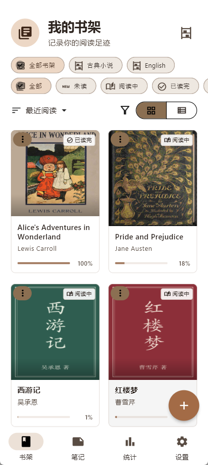
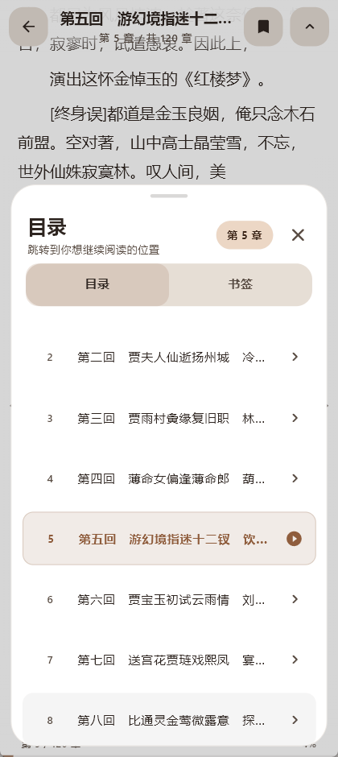
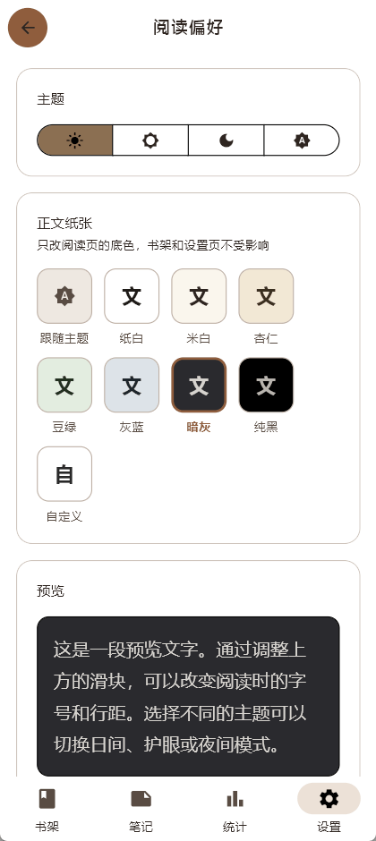
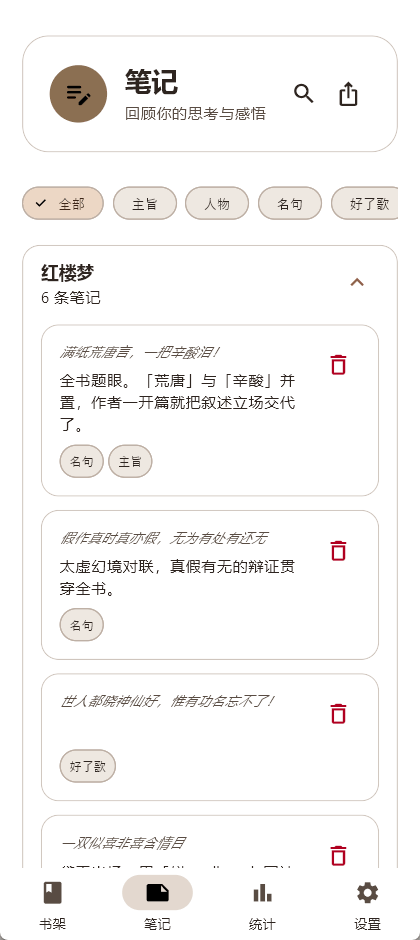
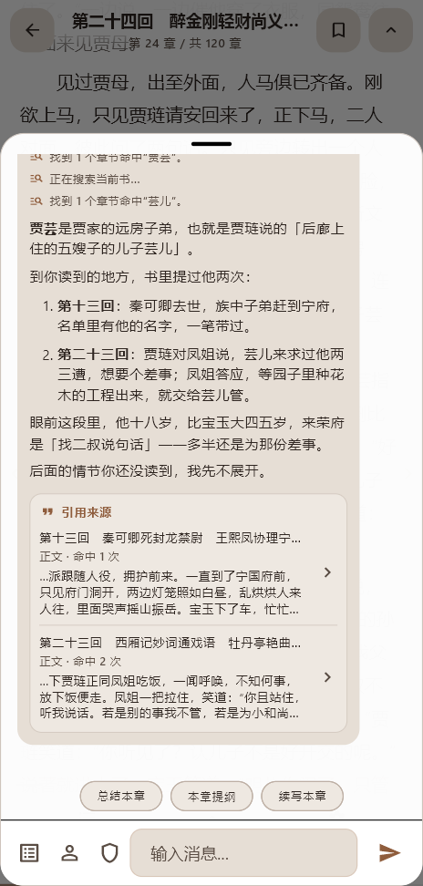
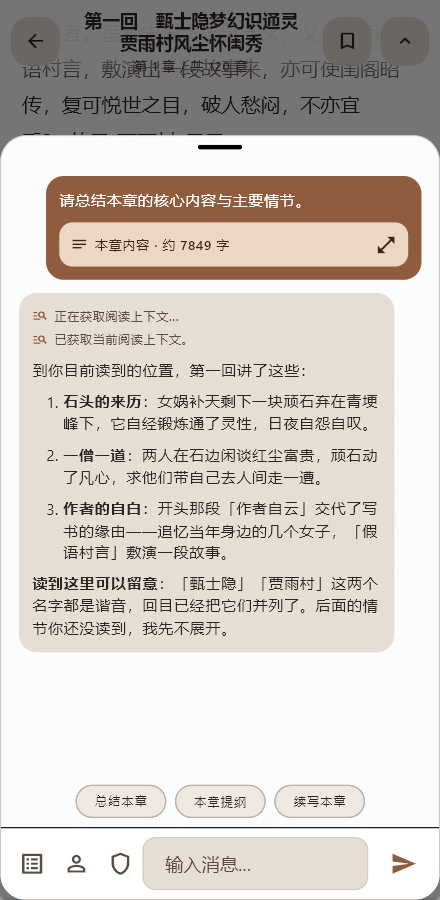
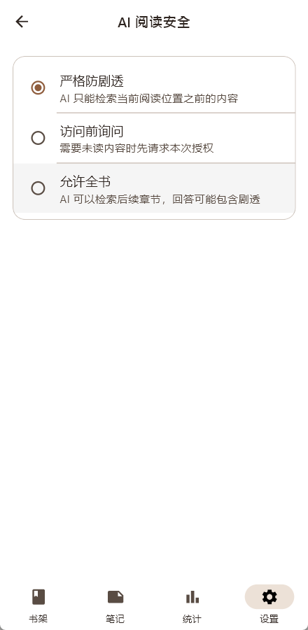
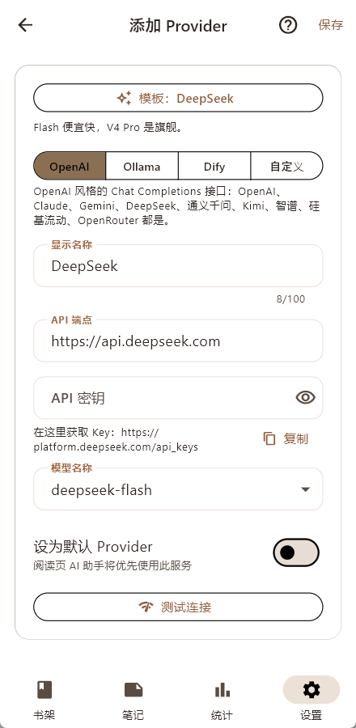
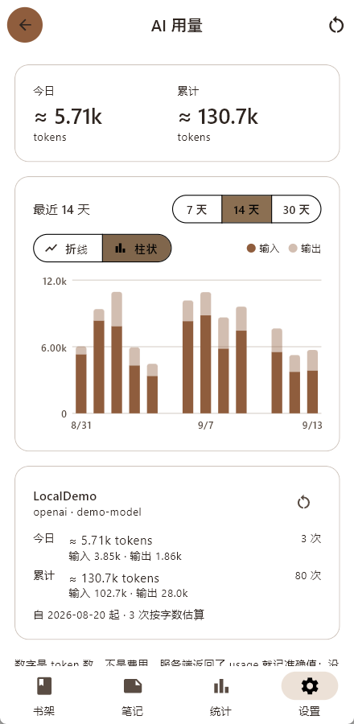
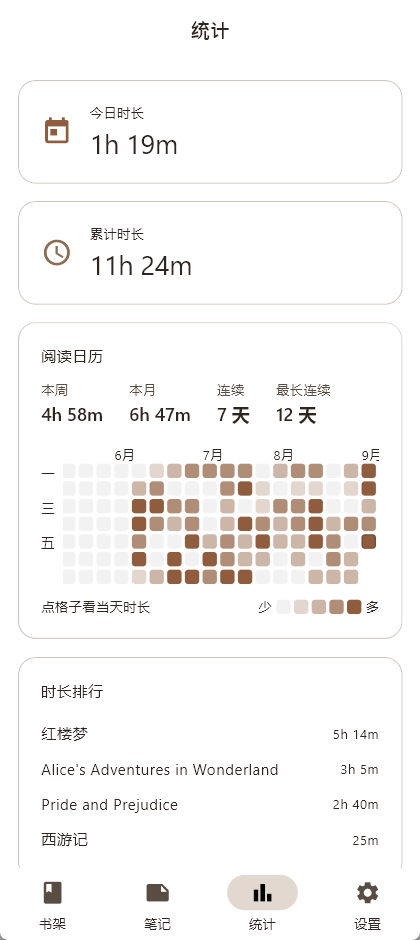

# 芸窗功能说明

各项功能的详细说明。概览、下载和开发说明见 [README](README.md)。

截图里的书都是公有领域作品；AI 回答来自本地模拟服务，只用来展示界面。

## 书架

支持自定义书架分组，一本书可属于多个书架，同时支持系列、阅读状态、网格 / 列表视图、排序、封面与元数据编辑。

桌面端可直接将文件或文件夹拖入窗口。

Android 可通过文件管理器「打开方式」或其他应用分享导入。

导入时自动识别 GBK / GB18030 / UTF-16 等编码，TXT 可按中英文章节标题自动分章（序章、尾声、番外这类标题也能认出来），并从开头几行识别书名和作者（认不出书名时用文件名）。

## 阅读

| 格式   | 支持情况                     |
| ---- | ------------------------ |
| EPUB | 可选中文本、划词菜单，按 EPUB 规范读取封面 |
| PDF  | 页面渲染、划词查词、生词本，横屏支持双页     |
| TXT  | 自动分章、自动识别文本编码            |

支持：

* 滚动 / 分页两种阅读模式
* 仿真、滑动、简洁三种分页翻页效果；仿真模式保留书脊透视与翻页层次
* 分页模式除了左右滑动，也能用鼠标滚轮和键盘翻页：→ ↓ PageDown 空格下一页，← ↑ PageUp 上一页
* 阅读进度精确到章节内位置，退出后再次打开自动恢复原阅读位置
* 目录提供全书进度拖动栏，长篇小说可以直接拖到目标章节；正文顶部留白为独立偏好，不会叠加沉浸式工具栏高度
* Android 可启用「阅读时横屏」，进入阅读器自动横屏，退出后恢复

### 目录与跳转

支持目录、书签和跳转历史。

从目录、搜索结果或 AI 引用跳转到其他位置后，可以一键返回上一个阅读位置。

跳到搜索结果、AI 引用或笔记时，那句话停在屏幕上部，上面留几行上下文，并短暂高亮。

### 排版与纸张

支持调整：

* 字号
* 行高
* 页边距
* 段距
* 字距
* 字体
* 对齐方式
* 段首缩进

排版参数可以设置全局默认值，也可以按书单独覆盖。

正文底色独立于应用全局主题，可选择：

* 白
* 米白
* 杏仁
* 豆绿
* 灰蓝
* 暗灰
* 纯黑
* 自定义颜色

文字颜色会根据背景对比度自动调整。

因此可以单独使用黑底白字阅读，而不需要把整个书架和设置页面切换成暗色主题。

### EPUB

EPUB 正文会按照 HTML 的空白处理规则转换为适合阅读的文本：

* 硬换行自动折为空格
* 汉字之间不会错误插入空格
* 脚注链接可点击跳转

对于 Project Gutenberg 一类使用固定宽度硬换行的 EPUB，也能恢复成正常连续排版。

## 笔记

支持：

* 划线
* 高亮
* 批注
* 标签分类
* 笔记之间建立关联
* 按书分组
* 按标签筛选

支持从其他平台导入笔记：

* 微信读书 HTML
* Kindle `My Clippings.txt`
* CSV
* JSON

支持导出：

* Markdown
* CSV

## 搜索

芸窗提供统一搜索入口，可同时搜索：

* 书名 / 作者
* 笔记
* 正文全文

搜索结果可以直接跳转到原文位置。

中日韩文本使用子串匹配，正文通过 trigram 索引加速；其他语种使用 SQLite FTS5。

## AI 助手

可以直接在阅读页面向 AI 提问。

AI 助手内置四类工具：

* 搜索当前书籍
* 读取章节摘录
* 搜索笔记
* 读取当前阅读上下文

回答会逐段流式显示。也可以创建自定义技能，通过预设指令限制 AI 可以使用哪些工具；还可以创建角色人设、从书籍内容生成角色并与书中人物对话。

角色人格生成有明确的进度与取消入口，长任务中断后可从检查点继续；生成完成后可直接预览、编辑或启用。

AI 会根据问题按需调用工具。

回答下方会列出引用来源，点击引用可以直接跳回原文。

内置快捷问法包括：

* 总结本章
* 本章提纲
* 续写本章

AI 会话按书保存，可以随时新建话题重新开始。

内置提示词会优先处理最新问题，并把附件和当前阅读上下文作为回答依据，避免沿用旧话题答非所问。

### 防剧透

**默认开启严格防剧透。**

AI 能访问的书籍内容默认截止到当前阅读位置。

防剧透级别可以全局设置，也可以按书单独覆盖。

阅读页和 AI 面板都会用更深的底色标出当前选中的档位；按书覆盖时只影响当前书，不会改动全局设置。

| 档位        | 行为               |
| --------- | ---------------- |
| 严格防剧透（默认） | 只能检索当前阅读位置之前的内容  |
| 访问前询问     | 需要访问未读内容时先请求本次授权 |
| 允许全书      | 可以检索后续章节         |

限制在本地工具执行层生效。

越过已读边界的章节不会进入模型上下文，而不是单纯依赖提示词约束 AI。

### AI 服务商

支持：

* OpenAI 兼容接口
* Ollama
* Dify

同时内置常见服务商模板：

* OpenAI
* Claude
* Gemini
* DeepSeek
* 通义千问
* Kimi
* 智谱
* 硅基流动
* OpenRouter
* Ollama
* Dify

选择模板后，接口地址和模型信息会自动填充，只需要配置 API Key。

模型名称还可以直接从服务端拉取列表进行选择，不需要手动查阅文档填写。

API Key 只保存在本机，应用备份不会包含密钥。

### Token 用量

芸窗可以按 Provider 记录 AI Token 用量：

* 今日用量
* 累计用量
* 输入 Token
* 输出 Token
* 最近 7 / 14 / 30 天趋势

支持折线图和柱状图。

如果服务端返回标准 `usage` 数据，则记录准确值；如果没有返回，则根据文本长度估算并进行标记。用量页同时按模型代号拆分统计，Provider 后来换模型时，旧记录不会被重新标成当前模型。

芸窗只负责统计 Token 数量，不自动换算费用，因为不同服务商和模型的价格不同。

## 词典、生词本与翻译

### 离线词典

支持导入 StarDict 离线词典。

划词后即可查询，多本词典可以同时启用。

### 生词本

生词会记录来源书籍和原文位置，可以随时返回对应原文。

### 翻译

划选文本后可主动调用翻译。

翻译内容会发送给当前配置的默认 AI Provider，仅在用户主动点击翻译时发送。

## TTS

支持文本朗读：

* 从屏幕正中那一句开始读，停在章首时从头读
* 按段落朗读，正在读的段落高亮；滚动模式自动跟读，翻页模式读到页尾自动翻页
* 断点续播
* 独立语速调节
* 朗读计时
* 迷你播放器
* 全屏控制面板

默认使用系统语音引擎，完全离线。也可以在「设置 → TTS 设置」改用 OpenAI 兼容的外部语音服务（`POST /audio/speech`），如 OpenAI、硅基流动，或自建的 openai-edge-tts、Kokoro-FastAPI。启用后，朗读的文字会发送到你填写的服务地址。

个别 Windows 电脑上，系统语音引擎会启动失败。此时朗读面板会给出提示，改用外部语音服务即可，其他功能不受影响。

Android 端接入系统媒体会话，可以：

* 后台播放
* 在通知栏控制播放状态

## 阅读统计

支持查看：

* 今日阅读时长
* 本周阅读时长
* 本月阅读时长
* 累计阅读时长
* 连续阅读天数
* 单书阅读时长排行
* 年度阅读热力图

## 备份

支持一键导出完整 ZIP 备份，包括：

* 数据库
* 书籍文件
* 封面
* 应用偏好
* 自定义背景图

可以从 ZIP 完整恢复。

同时支持上传备份到自己的 WebDAV 网盘，并设置：

* 每天自动上传
* 每周自动上传

备份中不会包含：

* AI API Key
* WebDAV 凭据
* 外部语音服务的设置（含 API Key）

Android 系统自动备份已关闭，因此本地书库不会被自动同步到 Google Drive。

## 外观

支持以下全局主题：

* Light
* Sepia
* Dark
* 跟随系统

全局背景可以选择：

* 纯色
* 主题色渐变
* 内置插画
* 自定义图片

背景浓度可以调节，并会应用到书架、设置页和阅读页。

界面动画默认开启，可以在「设置 → 外观」里关掉：打开书时从书封处展开，切换页面和底部标签有淡入淡出，卡片按下会轻轻回弹，翻页模式换章时旧章淡出、新章滑入。系统开启了「移除动画」时自动不播放。

