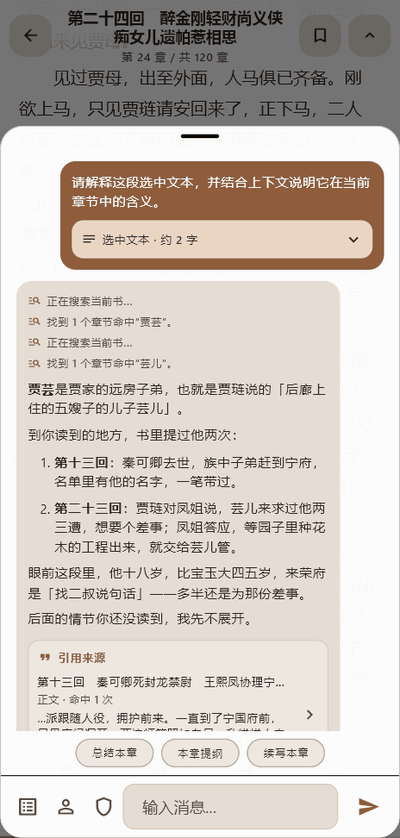

<div align="center">


# 芸窗 Yunchuang

**不剧透的 AI 阅读器**

读到第三百章，忘了这个人是谁？选中名字问 AI。<br>
它只看你读过的部分，回答附上原文出处，点一下就跳回去。

[](https://github.com/yarizm/Yunchuang/releases)
[](LICENSE)
[](https://flutter.dev/)
[](https://github.com/yarizm/Yunchuang/releases)

[下载](https://github.com/yarizm/Yunchuang/releases/latest) · [功能一览](#功能一览) · [详细说明](FEATURES.md) · [开发](#开发)


</div>

## 为什么用芸窗

**防剧透是硬限制。** AI 只能检索你读过的部分。没读到的章节在本地就被拦下，不会发给模型，不是靠提示词叮嘱它「别剧透」。想放开，可以按书改成「访问前询问」或「允许全书」。

**回答有出处。** AI 先在书里搜索、读原文，再回答。回答下面列出用到的章节和原文片段，点一下跳回原文。

**书在你自己手里。** 书籍、笔记、阅读记录都存在本机，不配 AI 也是完整的离线阅读器。要用 AI 就填自己的 Key：OpenAI 兼容接口、Claude、Gemini、DeepSeek、通义千问、Kimi、智谱、Ollama 本地模型都能接。

<p align="center">
  
</p>

## 下载

[**前往 Releases 下载最新版**](https://github.com/yarizm/Yunchuang/releases/latest)

| 平台      | 文件                                     | 要求                    |
| ------- | -------------------------------------- | --------------------- |
| Android | `yunchuang-<版本>-android-arm64-v8a.apk` | Android 7.0+，64 位 ARM |
| Windows | `yunchuang-<版本>-windows-x64.zip`       | Windows 10+，解压即用      |

截图和动图里的书都是公有领域作品，动图里的《红楼梦》取自维基文库。AI 回答来自本地模拟服务，只用来展示界面；搜索、出处、防剧透拦截都是应用实际执行的。

## 功能一览

* **阅读**：EPUB / PDF / TXT；滚动或分页（仿真翻页）；字号、行距、边距、纸张颜色可以按书单独设置
* **中文 TXT**：自动识别 GBK / UTF-16 等编码；按「第 X 章 / 回」分章，序章、尾声、番外也能认出来
* **AI**：防剧透问答、划词解释与翻译、总结 / 提纲 / 续写本章；从书里生成人物，和书中角色对话；按服务商统计 Token 用量
* **听书**：系统语音离线朗读，也可以接 OpenAI 兼容的语音服务；正在读的段落高亮，自动翻页，后台播放
* **笔记**：划线、高亮、批注、标签；导入微信读书、Kindle 笔记；导出 Markdown / CSV
* **查词**：StarDict 离线词典；生词本记下原文位置，随时跳回去
* **搜索**：书名、笔记、全文一起搜，中文按子串匹配
* **统计与备份**：阅读时长、连续天数、年度热力图；一键 ZIP 备份，可以定时上传到 WebDAV

每一项的详细说明和截图见 [FEATURES.md](FEATURES.md)。

<p align="center">
  
  
  
</p>

## 当前限制

| 项目 | 限制                                          |
| -- | ------------------------------------------- |
| 平台 | 当前仅支持 Android 和 Windows                     |
| 格式 | 暂不支持 MOBI / AZW3 / FB2                      |
| 同步 | WebDAV 当前用于完整备份包上传 / 下载，恢复会整体覆盖本机数据，不进行多端合并 |
| 排版 | 暂未实现中文标点挤压与禁则，正文默认左对齐                       |
| 界面 | 目前只有中文界面                                    |

## 开发

### 环境

| 层    | 技术                      |
| ---- | ----------------------- |
| 框架   | Flutter 3.x（Dart ≥ 3.4） |
| 状态管理 | Riverpod 2.x            |
| 路由   | GoRouter                |
| 数据库  | Drift + SQLite + FTS5   |
| 测试   | flutter_test + mocktail |

项目包含 100+ 个测试文件。

### 本地运行

```bash
flutter pub get
flutter run -d android
```

Windows：

```bash
flutter run -d windows
```

构建时不需要连 GitHub：SQLite 的预编译库和打过补丁的 flutter_tts 已放在 `third_party/`，原因和更新方法见 [third_party/README.md](third_party/README.md)。升级 sqlite3 包之后，运行 `.\tool\fetch_sqlite3.ps1` 更新预编译库；GitHub 连不上时，脚本会自动改用镜像下载。

生成的 `*.g.dart` 已随仓库提交，因此克隆项目后不需要先运行 `build_runner`。

修改以下目录中的 Drift 定义后，需要重新生成：

```text
lib/database/tables/
lib/database/daos/
```

运行：

```bash
dart run build_runner build
```

### Android Release 签名

复制：

```text
android/key.properties.example
```

为：

```text
android/key.properties
```

填写 keystore 信息后执行：

```bash
flutter build apk --release
```

### 独立测试数据目录

可以通过环境变量：

```text
YUNCHUANG_DATA_DIR
```

指定独立的数据目录。

数据库、书籍和封面都会写入该位置，适合：

* 测试新版本
* 调试
* 自动化测试
* 截图

不会影响真实书库。

应用偏好不在这个目录里：Windows 上仍是 `%APPDATA%\YARIZM\芸窗\shared_preferences.json`，和正常安装共用一份。测试中改了阅读或朗读设置，正式使用时也会看到；需要完全隔离时，先备份这个文件，测完再放回去。

## 项目结构

```text
lib/
├── main.dart / app.dart    # 应用入口与底部导航
├── database/               # Drift 表定义与 DAO
├── models/                 # 领域模型
├── providers/              # Riverpod Provider
│   └── ai/                 # AI Provider、Agent、防剧透边界
├── services/               # 书籍 / 笔记 / 搜索 / TTS / 备份 / 词典 / 翻译 / 生词
├── parsers/                # 书籍解析器与笔记导入器
├── typography/             # 分页排版内核
├── pages/                  # 页面
├── widgets/                # 共享组件
├── theme/                  # 主题与自定义路由
└── utils/                  # 断句、编码检测等工具
```

> 芸香草能防蠹，古人常用来护书；「芸窗」亦是书斋的雅称。

## License

本项目基于 [MIT License](LICENSE) 开源。
